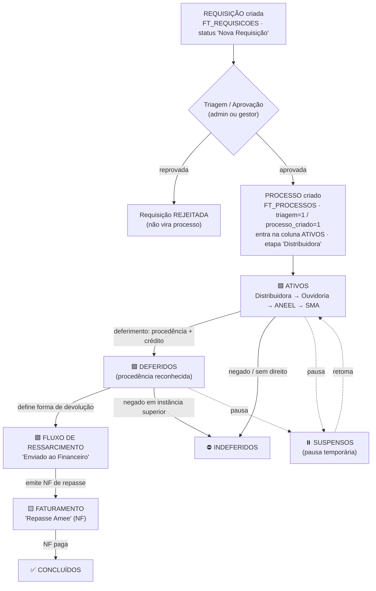
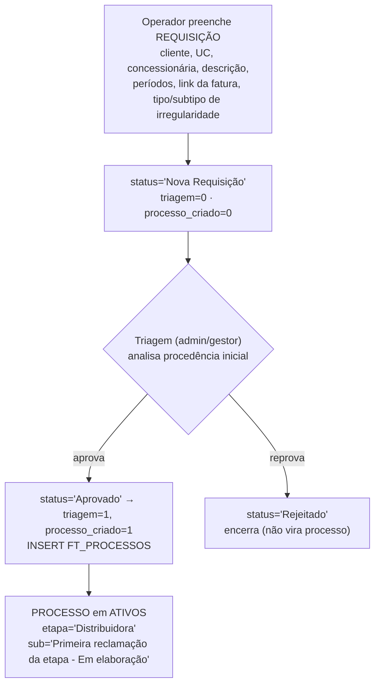
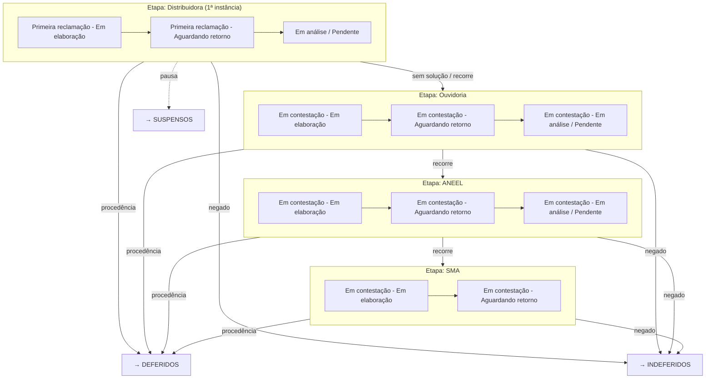
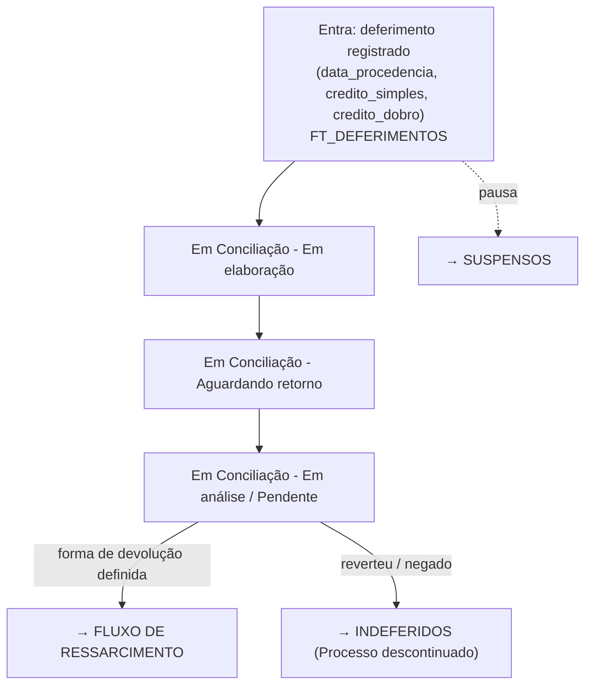
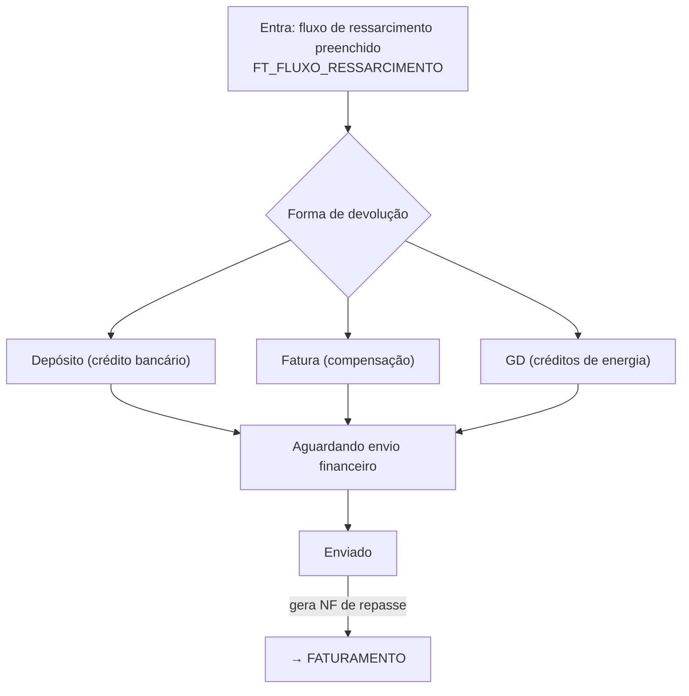
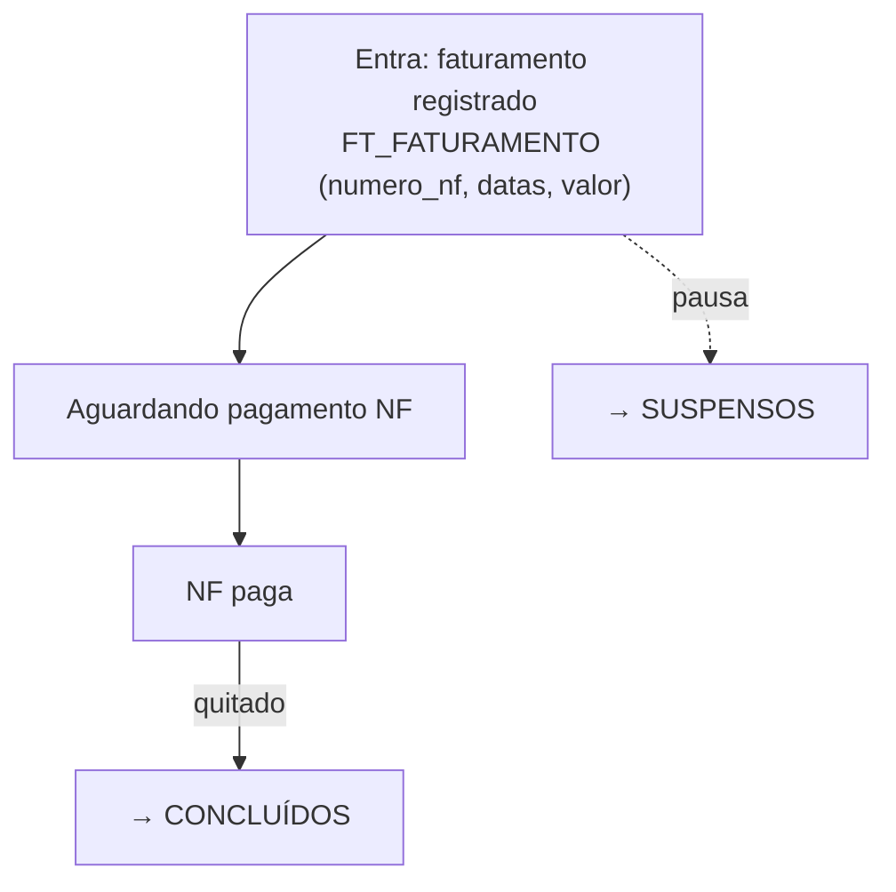
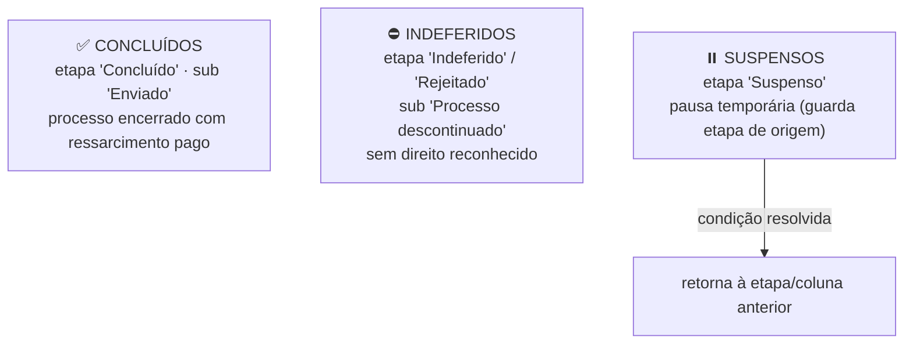

# Fluxo de Trabalho — Da Requisição à Conclusão do Processo

> Mapa do fluxo de análise de processos de ressarcimento, do cadastro da **requisição** até a **conclusão**, com o detalhe de cada coluna do Kanban.
> Fontes: `FT_REQUISICOES`, `FT_PROCESSOS`, `DM_ETAPAS_PROCESSO`, `DM_KANBAN_COLUNAS`, `FT_HISTORICO_MOVIMENTACOES` + handlers Go (`requisicao_handler.go`, `processo_handler.go`) e front (`ControleProcessos.jsx`, `ProcessoDrawer.jsx`).
> Os diagramas usam **Mermaid** (renderiza no GitHub/VS Code).

---

## 1. Visão geral

**Resumo:** Requisição → (triagem) → Processo em **Ativos** → escalonamento por órgão (Distribuidora → Ouvidoria → ANEEL → SMA) → **Deferidos** (quando há procedência) → **Fluxo de Ressarcimento** (forma de devolução) → **Faturamento** (NF) → **Concluídos**. Sem direito → **Indeferidos**. Pausa → **Suspensos**.

---

## 2. As 7 colunas do Kanban (mapa etapa → coluna)

| Coluna (`DM_KANBAN_COLUNAS`) | id | Etapas canônicas (`DM_ETAPAS_PROCESSO`) | Papel no fluxo |
|---|--:|---|---|
| **Ativos** | 1 | Distribuidora, Ouvidoria, ANEEL, SMA | Análise/contestação em andamento nos órgãos |
| **Deferidos** | 2 | (Pendente, Em Conciliação, Em Contestação)¹ | Procedência reconhecida — em conciliação de crédito |
| **Fluxo de Ressarcimento** | 3 | Enviado ao Financeiro | Define como o crédito será devolvido |
| **Faturamento** | 4 | Repasse Amee | Emissão e pagamento da NF de repasse |
| **Concluídos** | 5 | Concluído | Processo finalizado (terminal) |
| **Indeferidos** | 6 | Indeferido, Rejeitado | Sem direito / descontinuado (terminal) |
| **Suspensos** | 7 | Suspenso² | Paralisado temporariamente |

> ¹ Na prática, a coluna **Deferidos** guarda os mesmos órgãos (Distribuidora/Ouvidoria/ANEEL) — a `nome_coluna`/`id_coluna` é gravada pelo `movimentar` quando há **deferimento**, independente da etapa canônica. O que define a coluna é a ação (deferimento/fluxo/faturamento), não só a etapa.
> ² A etapa "Suspenso" tem `id_coluna_kanban = NULL`; a coluna Suspensos (id 99) é resolvida pelo handler. O processo guarda a etapa de origem para poder **retomar**.

**Endpoint central de movimentação:** `POST /api/v1/processos/{id}/movimentar` (`processo_handler.go`). Cada movimento grava em `FT_HISTORICO_MOVIMENTACOES` (etapa anterior→nova, sub-etapa, comentário, canal, data).

---

## 3. Requisição → Processo (entrada do fluxo)

- **Criação:** `POST /api/v1/requisicoes` (`CreateRequisicaoPersist`). Histórico `tipo='criacao'` (uma entrada por fatura selecionada).
- **Triagem/aprovação:** ao aprovar, marca `triagem=1` + `processo_criado=1` e cria o `FT_PROCESSOS` já na coluna **Ativos**, etapa **Distribuidora**.

---

## 4. 🟦 ATIVOS — escalonamento por órgão

A análise sobe degraus de instância: **Distribuidora → Ouvidoria → ANEEL → SMA**. Em cada etapa há um ciclo de sub-etapas (elaborar → enviar → aguardar retorno → analisar).

- **Entra:** ao criar o processo (Distribuidora).
- **Sai para:** Deferidos (procedência), Indeferidos (negado), Suspensos (pausa).
- **Ciclo de sub-etapa:** `Em elaboração` → `Aguardando retorno` → `Em análise` → `Pendente`.

---

## 5. 🟩 DEFERIDOS — procedência reconhecida

Disparado quando o operador registra **deferimento** (data de procedência + crédito simples/dobro) na ação de movimentar. O processo continua nos órgãos (Distribuidora/Ouvidoria/ANEEL) mas agora na coluna Deferidos, tipicamente em **conciliação**.

- **Dado-chave:** `FT_DEFERIMENTOS` (`data_procedencia`, `credito_simples`, `credito_dobro`, `data_credito_dobro`).
- **Sai para:** Fluxo de Ressarcimento (define devolução) ou Indeferidos.

---

## 6. 🟪 FLUXO DE RESSARCIMENTO — como o crédito volta

Etapa **"Enviado ao Financeiro"**. Define a **forma de devolução** do valor ao cliente.

- **Dado-chave:** `FT_FLUXO_RESSARCIMENTO` (`forma_devolucao` = Depósito/Fatura/GD, `valor`, `data_envio_financeiro`).
- **Sub-etapas:** `Aguardando envio financeiro` → `Enviado`.
- **Sai para:** Faturamento.

---

## 7. 🟨 FATURAMENTO — NF de repasse

Etapa **"Repasse Amee"**. Emissão e acompanhamento do pagamento da Nota Fiscal de repasse.

- **Dado-chave:** `FT_FATURAMENTO` (`numero_nf`, `data_emissao`, `data_vencimento`, `data_pagamento`, `valor`).
- **Sub-etapa:** `Aguardando pagamento NF` → pago.
- **Sai para:** Concluídos.

---

## 8. ✅ CONCLUÍDOS / ⛔ INDEFERIDOS / ⏸️ SUSPENSOS (terminais e pausa)

- **Concluídos** e **Indeferidos** são **terminais** (sem ação de movimentação).
- **Suspensos** é **pausa**: o card sai do fluxo ativo e volta quando a pendência é resolvida.

---

## 9. Histórico e auditoria (transversal a tudo)

Cada movimento (criação, movimentação, comentário, deferimento, fluxo, faturamento) grava em **`FT_HISTORICO_MOVIMENTACOES`**:

- `id_requisicao` (= id_processo), `id_usuario_gestor`
- `etapa_anterior` → `etapa_nova`, `sub_etapa`
- `comentario` + **canal** (WhatsApp / Ligação / E-mail / SMS / Site / Pessoal → `FT_HISTORICO_CANAIS`)
- `tipo_movimentacao` (`criacao` | `movimentacao` | `comentario` | `fatura`)
- `data_movimentacao`

O `FT_PROCESSOS` deve refletir a **última movimentação** (sincronizado por `SincronizarStatusProcesso`).

---

## 10. Endpoints do fluxo

| Método | Rota | Função |
|---|---|---|
| POST | `/api/v1/requisicoes` | Cria requisição |
| PUT  | `/api/v1/requisicoes/{id}` | Aprova/rejeita (triagem → cria processo) |
| POST | `/api/v1/processos/{id}/movimentar` | Move etapa/coluna + grava histórico |
| POST | `/api/v1/fluxo-ressarcimento/{id}` | Salva forma de devolução |
| POST | `/api/v1/faturamento/{id}` | Salva dados da NF |
| GET  | `/api/v1/processos/kanban-fast` | Lista processos por coluna (Kanban) |
| GET  | `/api/v1/requisicoes/{id}/historico` | Timeline de movimentações |

---

## 11. Notas / inconsistências observadas nos dados (jun/2026)

- **Sub-etapas misturadas:** há ruído (`Em elaboração` genérico, `Suspenso` espalhado em várias etapas, `sub_etapa` NULL/`''`). O fluxo "ideal" acima é o pretendido; o dado real tem desvios.
- **Coluna ≠ etapa canônica:** Deferidos/Suspensos guardam etapas de órgão (Distribuidora/Ouvidoria/ANEEL) — a coluna vem da ação (deferimento/suspensão), não só do `DM_ETAPAS_PROCESSO`.
- **325 processos em Suspensos** estão como `Distribuidora` com `sub_etapa` NULL — provável represamento na 1ª instância.
- **403+180 em Indeferido dentro da coluna "Ativos"** — etapa Indeferido aparecendo fora da coluna Indeferidos: dessincronização etapa×coluna (candidato a correção de dados).
